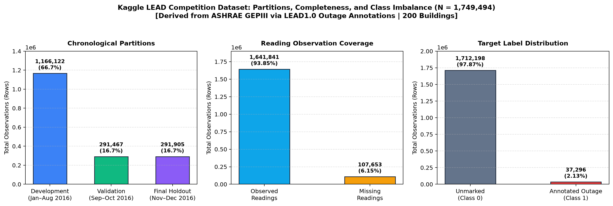
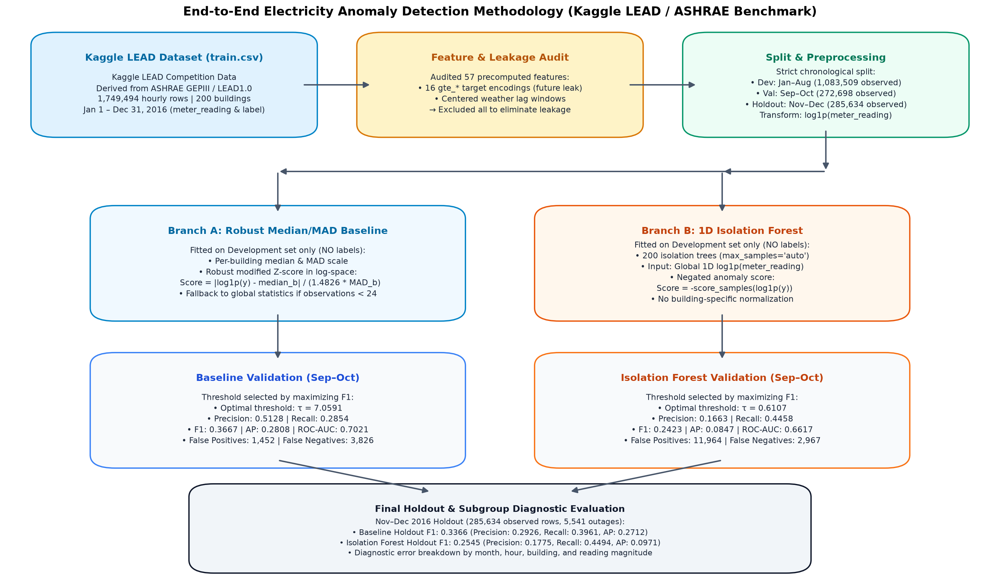
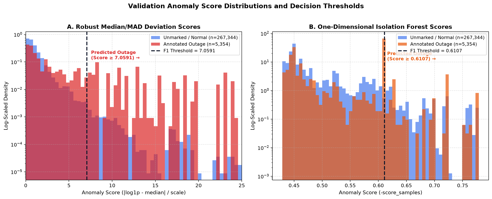
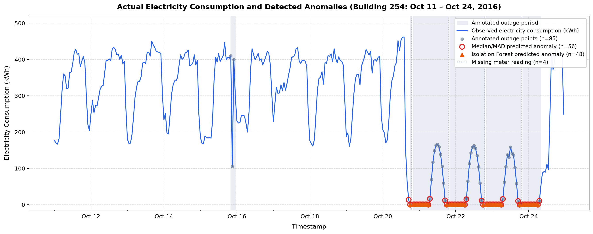
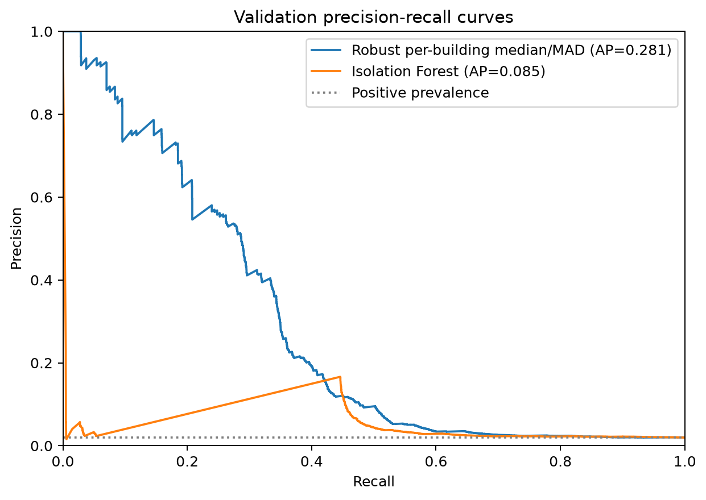
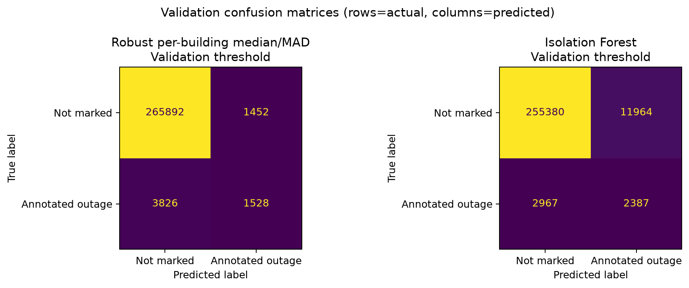
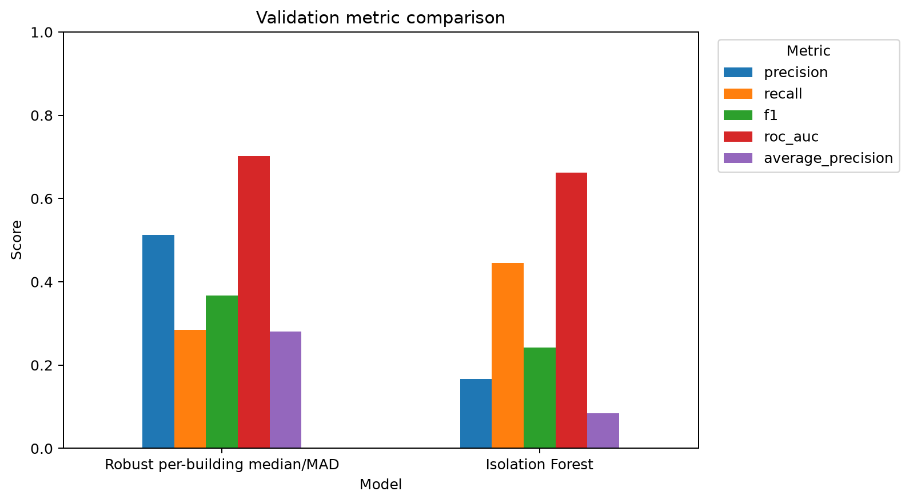
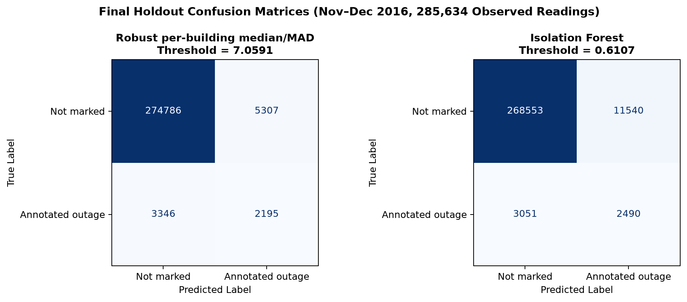
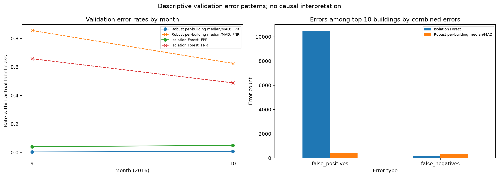

# Detection of Abnormal Electricity Consumption Using Unsupervised Learning

**Author:** Avantika Choudhary  
**Institution:** Atal Bihari Vajpayee Indian Institute of Information Technology and Management (ABV-IIITM), Gwalior  
**Course:** Machine Learning Techniques  
**Instructor:** Dr. Yashwant Singh Patel  
**Submission Date:** 22 October 2026  
**Repository:** [https://github.com/avantika9773-svg/Anomaly-Detection](https://github.com/avantika9773-svg/Anomaly-Detection)

---

## 1. Abstract

This project investigates the unsupervised detection of abnormal electricity consumption across a commercial building fleet using the Kaggle Community Prediction Competition benchmark dataset **Large-scale Energy Anomaly Detection (LEAD)**. Through a forensic dataset provenance audit, this benchmark was verified as a three-tier derived dataset: its underlying physical meter telemetry and ambient weather observations originate upstream from the **ASHRAE Great Energy Predictor III (GEPIII)** commercial building meter dataset (2019); its anomaly annotations were created by Gulati and Arjunan (2022) as part of the **LEAD1.0** research benchmark using an interactive R Shiny annotation tool (`combine_anomaly.R`) to record logged power outage indices; and its immediate distribution package was released as an official Kaggle Community Prediction Competition comprising an exact subset of 200 labeled commercial training buildings (1,749,494 hourly records across calendar year 2016) and 206 test buildings (1,800,567 records). The target variable is severely imbalanced: only 37,296 records (2.13%) are annotated as power outages, while the remaining 1,712,198 records (97.87%) represent unmarked observations (label 0).

Because an audit of the precomputed feature files revealed significant data leakage risks—specifically target encodings (`gte_*`) computed over full-year consumption and bidirectional centered rolling weather windows—all 57 precomputed features were discarded. The experimental pipeline strictly evaluates observed `meter_reading` values transformed via $\log(1 + \text{meter\_reading})$, preserving a strict forward-in-time chronological split: January–August 2016 for model development, September–October 2016 for validation and threshold selection, and November–December 2016 as a reserved final holdout partition.

Critically, **model fitting is strictly unsupervised**: both detectors are trained exclusively on unlabelled development telemetry without exposure to anomaly labels. Ground-truth outage labels are utilized solely on the validation partition to calibrate decision thresholds (maximizing the F1 score) and to conduct retrospective diagnostic evaluations. Two unsupervised detection strategies are evaluated:
1. A domain-aware **Per-building Robust Median/MAD statistical baseline**, which normalizes readings by building-specific scale and center.
2. A standard **One-dimensional Isolation Forest** (200 isolation estimators), trained globally across all development readings.

On 272,698 observed validation records (containing 5,354 annotated outages, 1.963%, and 267,344 unmarked observations, 98.037%), the Per-building Median/MAD baseline achieved a precision of **0.5128**, recall of **0.2854**, F1 score of **0.3667**, ROC-AUC of **0.7021**, and Average Precision (PR-AUC) of **0.2808**, generating 1,452 false positives. In contrast, the one-dimensional Isolation Forest achieved a precision of **0.1663**, recall of **0.4458**, F1 score of **0.2423**, ROC-AUC of **0.6617**, and Average Precision of **0.0847**, generating 11,964 false positives (an 8.2× increase in false alarms). On the final holdout evaluation (285,634 observed records), the Median/MAD baseline maintained superior ranking and F1 performance (F1 = **0.3366**, AP = **0.2712**) compared to Isolation Forest (F1 = **0.2545**, AP = **0.0971**).

The empirical evidence demonstrates that incorporating building-specific scale normalization is critical in commercial building energy monitoring; a global 1D Isolation Forest confuses inter-building scale differences with within-building anomalies. All evaluations exclude missing readings (which carry label 0 exclusively), and positive labels are interpreted strictly as recorded outage annotations rather than exhaustive anomaly ground truth.

---

## 2. Introduction and Problem Statement

### 2.1 Problem Statement and Motivation
Commercial and institutional facilities account for a substantial portion of global energy consumption. Undetected power outages, equipment faults, scheduling blunders, and electrical sensor drifts lead to operational disruption, equipment degradation, and significant economic waste. In facility management operations, early and accurate identification of abnormal electrical behavior is critical.

However, supervised anomaly detection is rarely viable in practical energy systems. High-quality, verified fault labels are exceedingly scarce, expensive to curate, and rarely cover the wide spectrum of potential failure modes. Consequently, energy anomaly detection must generally be formulated as an **unsupervised learning task**: models must learn intrinsic baseline operating profiles directly from unlabelled time-series telemetry without any exposure to anomaly labels during fitting. Ground-truth annotations are reserved strictly for retrospective decision threshold calibration and offline diagnostic performance validation.

### 2.2 Operational Context in Building Fleet Telemetry
Automating anomaly detection across large building portfolios introduces four primary technical challenges:
1. **Extreme Class Imbalance:** Severe power disruptions are rare events, typically constituting under 2.5% of total operating hours. Standard classification metrics like accuracy are completely misleading (a trivial zero-detector achieves >98.0% accuracy on validation while detecting zero outages).
2. **Extreme Inter-Building Heterogeneity:** Energy consumption scales vary across facilities by multiple orders of magnitude. A small administrative office may operate around 20–50 kWh, whereas a major research laboratory or data center operates around 2,000–5,000 kWh. Global thresholds or global distance metrics risk flagging entire normal facilities as anomalous simply due to their absolute magnitude.
3. **Severe Operational Cost of False Alarms:** In real-world facility operations, every triggered anomaly alert incurs an operational screening and triage cost (BMS telemetry cross-checks, historical log reviews, and potential on-site technician inspections). A detector that generates hundreds of unverified alerts per day causes rapid **operator alarm fatigue**, risking that monitoring notifications are muted or disabled altogether.
4. **Ground-Truth Ambiguity & Target Scope:** In benchmark energy telemetry, recorded labels represent logged power outages rather than verified absolute normality or an exhaustive catalog of all electrical faults. Class 0 signifies an **unmarked observation (label 0)**, not certified fault-free operation. Unannotated equipment faults, sensor drifts, and schedule blunders may remain unflagged in class 0.

---

## 3. Background and Related Work

### 3.1 Unsupervised Energy Anomaly Detection Paradigms
Unsupervised anomaly detection methods in time-series telemetry fall broadly into two primary paradigms:
1. **Statistical Profiling and Robust Z-Scores:** Methods that establish expected central tendencies (mean, median) and dispersion scales (standard deviation, interquartile range, median absolute deviation) for specific entities. Because standard sample means and variances are sensitive to the very anomalies they aim to detect, robust statistics—specifically the median and Median Absolute Deviation (MAD)—are preferred in real-world engineering telemetry (Chandola et al., 2009).
2. **Tree-Based Space Partitioning (Isolation Forests):** Methods that isolate anomalies rather than profiling normal points. Liu, Ting, and Zhou (2008) introduced Isolation Forest, which exploits the geometric property that anomalous points require fewer random axis-aligned splits to isolate than clustered normal points.

### 3.2 Literature Survey & Benchmark Lineage
* **ASHRAE Great Energy Predictor III (GEPIII):** Organised in 2019, ASHRAE GEPIII provided hourly meter readings from 1,449 commercial buildings across 16 university and institutional sites for energy forecasting. However, GEPIII was an engineering forecasting competition and contained **zero ground-truth anomaly annotations**.
* **LEAD1.0 Benchmark:** Gulati and Arjunan (2022) developed LEAD1.0 as a large-scale annotated benchmark by extracting meter series from ASHRAE GEPIII and annotating logged power outages (`outage_indices`) using an interactive R Shiny tool (`combine_anomaly.R`). Their paper benchmarked unsupervised and semi-supervised algorithms on 24-hour daily profile vectors across 1,413 buildings.
* **Kaggle LEAD Community Competition:** To foster point-level anomaly detection, Arjunan and Gulati released a dedicated competition subset comprising 200 labeled training buildings and 206 test buildings evaluated at **hourly per-reading resolution** for binary power outages.

### 3.3 Contrast with Alternative Public Datasets
Public energy datasets hosted on platforms such as the UCI Machine Learning Repository differ fundamentally from this project's scope:
* **UCI Individual Household Electric Power Consumption (`dataset/235`):** Measures a single private residence in Sceaux, France, at 1-minute intervals from 2006 to 2010 with 9 electrical features (`Global_active_power`, `Voltage`, sub-metering). It contains zero building identifiers, zero multi-facility heterogeneity, and **zero anomaly labels**.
* **UCI ElectricityLoadDiagrams20112014 (`dataset/321`):** Measures 370 Portuguese client electricity delivery points for load forecasting without ground-truth fault labels.

In contrast, the dataset analyzed here represents multi-facility enterprise telemetry from commercial and institutional campuses with hand-curated outage labels.

---

## 4. Dataset and Provenance

### 4.1 Verified Three-Tier Lineage
A forensic audit confirmed that the experimental dataset in this workspace is a **three-tier derived benchmark**:
1. **Tier 1 (Upstream Telemetry):** *ASHRAE Great Energy Predictor III (GEPIII)* (2019). Provided raw hourly electricity meter readings (`meter_reading` in kWh), building physical metadata, and ambient weather telemetry across campus sites.
2. **Tier 2 (Academic Annotation Layer):** *LEAD1.0* (Gulati & Arjunan, arXiv:2203.17256, 2022). Annotated 37,296 power outage hours using a custom R Shiny tool (`combine_anomaly.R` in `github.com/samy101/lead-dataset`).
3. **Tier 3 (Immediate Distribution Package):** *Kaggle Community Prediction Competition: Large-scale Energy Anomaly Detection (LEAD)* (`https://www.kaggle.com/competitions/energy-anomaly-detection`). Packaged 200 training buildings (1,749,494 rows) and 206 test buildings (1,800,567 rows) with 57 precomputed features.

### 4.2 Raw Telemetry Files and Structural Summary
The repository contains five primary CSV files:

| File Name | Shape | Columns | Role in Project |
|---|---:|---|---|
| `train.csv` | 1,749,494 rows × 4 cols | `building_id`, `timestamp`, `meter_reading`, `anomaly` | Labeled development, validation, and holdout data across 200 buildings in 2016. |
| `test.csv` | 1,800,567 rows × 4 cols | `row_id`, `building_id`, `timestamp`, `meter_reading` | Unlabeled competition test set covering 206 buildings. |
| `train_features.csv` | 1,749,494 rows × 57 cols | 57 precomputed metadata, weather, lag, and target encodings | Audited and discarded due to future-lookahead data leakage. |
| `test_features.csv` | 1,800,567 rows × 57 cols | 57 precomputed test features | Discarded for pipeline parity. |
| `sample_submission.csv` | 1,800,567 rows × 2 cols | `row_id`, `anomaly` | Competition submission format template. |

Figure 1 summarizes the partition dimensions, observation completeness, and severe target label imbalance.

**Figure 1.** Kaggle LEAD Competition Dataset Overview: (Left) Chronological sample sizes across Development, Validation, and Holdout partitions; (Center) Observed versus missing meter reading coverage; (Right) Extreme target label imbalance between unmarked observations and annotated outages ($N = 1,749,494$). Dataset derived from ASHRAE GEPIII via LEAD1.0 outage annotations.

---

## 5. Data Quality and Preprocessing

### 5.1 Observation Completeness & Missing Reading Exclusion Protocol
A comprehensive scan of all 1,749,494 raw training rows established:
* **Timestamps:** Hourly coverage from `2016-01-01 00:00:00` to `2016-12-31 23:00:00`. Zero duplicate records; zero invalid timestamps.
* **Missing Readings:** 107,653 readings (6.153%) are missing (`NaN`). Missingness varies by month (1.89% in November to 10.65% in March) and across facilities (177 of 200 buildings have missing values).
* **Missing-Data Label Correlation:** Exactly 100% of the 107,653 missing readings carry label 0. Zero annotated outages coincide with missing readings. Because label 0 denotes unmarked observations rather than certified normal operation, missing readings represent unobserved telemetry intervals where no outage was annotated.
* **Exclusion Protocol:** Because a reading-based detector cannot compute statistical z-scores or isolation tree splits on `NaN`, missing readings are excluded from evaluation. This shifts observed positive prevalence to 2.27% overall (and 1.963% in validation).

### 5.2 Feature Audit and Data Leakage Controls
A systematic audit of the 57 precomputed columns in `train_features.csv` revealed three severe data leakage mechanisms:
1. **Full-Year Target Encodings (`gte_*`):** 16 columns (e.g., `gte_hour`, `gte_building_id`, `gte_meter_building_id_month`) encoded $\log(1 + \text{meter\_reading})$ using group statistics calculated over the **entire calendar year**, leaking future-period and same-row consumption into historical records.
2. **Centered Weather Moving Windows:** 8 rolling columns (`air_temperature_*_lag7`, `lag73`) utilized centered moving windows, incorporating future ambient weather observations into past timestamps.
3. **Bidirectional Weather Imputation:** Missing meteorological observations were interpolated forward and backward in time.

Consequently, **all 57 precomputed features were discarded**. The experimental models use solely the directly observed `meter_reading` variable transformed via $\log(1 + \text{meter\_reading})$.

### 5.3 Chronological Partitioning Protocol
To guarantee strict leakage-free evaluation, observations were ordered chronologically into three non-overlapping calendar partitions:

| Partition | Calendar Dates (Inclusive) | Total Rows | Observed Readings | Missing Readings | Annotated Outages | Positive Prevalence |
|---|---|---:|---:|---:|---:|---:|
| **Development** | 2016-01-01 to 2016-08-31 | 1,166,122 | 1,083,509 | 82,613 | 26,401 | 2.437% |
| **Validation** | 2016-09-01 to 2016-10-31 | 291,467 | 272,698 | 18,769 | 5,354 | 1.963% |
| **Final Holdout** | 2016-11-01 to 2016-12-31 | 291,905 | 285,634 | 6,271 | 5,541 | 1.940% |

All models and development statistics were fitted on the 1,083,509 observed development readings **strictly without label access**. Validation labels were used exclusively for retrospective threshold selection (maximizing F1) and diagnostic error analysis. The final holdout partition was strictly sequestered until validation decisions were locked and was evaluated once with fixed thresholds.

---

## 6. Methodology

### 6.1 End-to-End Experimental Architecture
The end-to-end experimental workflow is illustrated in Figure 2.

**Figure 2.** End-to-End Experimental Methodology Flowchart: Showing the chronological data progression from Kaggle LEAD electricity records (derived from ASHRAE / LEAD1.0) through leakage auditing, log-transformation, parallel unsupervised fitting of Baseline and Isolation Forest branches without anomaly labels, validation threshold calibration using validation labels to maximize F1, and final diagnostic holdout evaluation.

### 6.2 Model A: Per-Building Robust Median/MAD Statistical Baseline
The statistical baseline explicitly models building-specific consumption scale without label supervision. For each building $b$, development readings are used to calculate the median and Median Absolute Deviation (MAD) in log-space:
$$\text{Center}_b = \text{median}(\log(1 + y_b))$$
$$\text{Scale}_b = 1.4826 \times \text{median}\left(|\log(1 + y_b) - \text{Center}_b|\right)$$
where $1.4826$ is the normal consistency factor. If a building has fewer than 24 development observations or zero MAD, the model falls back to the global development median and MAD. For any observed reading $y$ of building $b$, the anomaly score is the modified Z-score:
$$\text{Score}_{\text{Baseline}}(y, b) = \frac{|\log(1 + y) - \text{Center}_b|}{\text{Scale}_b}$$
Observations with $\text{Score}_{\text{Baseline}} \ge \tau_{\text{Baseline}}$ are classified as anomalies.

### 6.3 Model B: One-Dimensional Isolation Forest
The machine learning benchmark implements an Isolation Forest (`n_estimators=200`, `max_samples='auto'`, `contamination='auto'`, `random_state=42`, `n_jobs=-1`) fitted on the 1D global development array of $\log(1 + \text{meter\_reading})$ **strictly without label access**. Because scikit-learn defines `score_samples` such that negative scores denote anomalies, scores are negated:
$$\text{Score}_{\text{IF}}(y) = -\text{score\_samples}(\log(1 + y))$$
Observations with $\text{Score}_{\text{IF}} \ge \tau_{\text{IF}}$ are classified as anomalies.

*Critical 1D Limitation:* Because this Isolation Forest operates exclusively on the 1D scalar $\log(1 + \text{meter\_reading})$, it has no access to `building_id`, time of day, day of week, or weather. It treats all 200 buildings as a single global distribution, assuming that anomalies reside exclusively at the global tails of consumption.

---

## 7. Experimental Design and Evaluation Metrics

### 7.1 Forward-in-Time Evaluation Principles
Energy telemetry is intrinsically auto-correlated and non-stationary. Standard random $k$-fold cross-validation is completely invalid because it allows past observations to be predicted using future data, introducing artificial look-ahead leakage. This experiment enforces strict **forward-in-time chronological boundaries**: models learn exclusively from the past (Jan–Aug), tune thresholds on the intermediate period (Sep–Oct), and are evaluated once on the future holdout (Nov–Dec).

### 7.2 Metric Selection Under Extreme Imbalance
With an anomaly prevalence of under 2%, accuracy is uninformative (a naive null detector achieves 98.037% accuracy on validation). The evaluation focuses on metrics sensitive to the minority class:
* **Precision:** $\text{TP} / (\text{TP} + \text{FP})$ — operational reliability of alerts.
* **Recall:** $\text{TP} / (\text{TP} + \text{FN})$ — proportion of genuine outages successfully caught.
* **F1 Score:** Harmonic mean of precision and recall.
* **Average Precision (PR-AUC):** Area under the Precision-Recall curve, measuring ranking quality across all decision thresholds.
* **ROC-AUC:** Area under the ROC curve (sensitive to true negative volume).

### 7.3 Validation Threshold Selection Policy
Because the models are fitted in an unsupervised manner, decision thresholds cannot be established during training. Instead, decision thresholds were calibrated retrospectively on the validation partition (Sep–Oct 2016) by evaluating candidate thresholds across the Precision-Recall curve to identify the threshold that maximizes the F1 score:
* **Median/MAD Baseline:** $\tau_{\text{Baseline}} = \mathbf{7.0591}$
* **Isolation Forest:** $\tau_{\text{IF}} = \mathbf{0.6107}$

In the event of score ties, the policy selects the higher threshold to prioritize conservative alerting.

---

## 8. Results and Comparative Analysis

### 8.1 Validation Results Summary
Table 1 summarizes the performance metrics on the 272,698 observed validation records (containing 5,354 annotated outages).

**Table 1. Validation Performance Comparison (Sept–Oct 2016, 272,698 Observed Readings)**

| Evaluation Metric | Robust Median/MAD Baseline | One-Dimensional Isolation Forest | Relative Baseline Advantage |
|---|---:|---:|:---:|
| **Decision Threshold ($\tau$)** | `7.0591` | `0.6107` | Fixed for Holdout |
| **Precision** | **0.5128** | 0.1663 | **+3.08×** |
| **Recall** | 0.2854 | **0.4458** | -0.36× |
| **F1 Score** | **0.3667** | 0.2423 | **+51.3%** |
| **ROC-AUC** | **0.7021** | 0.6617 | **+0.0404** |
| **Average Precision (PR-AUC)** | **0.2808** | 0.0847 | **+3.32×** |
| **True Positives (TP)** | 1,528 | **2,387** | +859 outages detected |
| **False Positives (FP)** | **1,452** | 11,964 | **-10,512 false alarms (-87.9%)** |
| **True Negatives (TN)** | **265,892** | 255,380 | — |
| **False Negatives (FN)** | 3,826 | **2,967** | — |
| **False Positive Rate (FPR)** | **0.543%** | 4.475% | **8.2× lower false alarm rate** |
| **False Negative Rate (FNR)** | 71.461% | **55.417%** | — |

Figure 3 illustrates the empirical score distributions for unmarked observations (label 0) and annotated outages (label 1) alongside their respective decision thresholds.

**Figure 3.** Validation Anomaly Score Distributions and Decision Thresholds: (Panel A) Robust Median/MAD deviation scores showing sharp decay for unmarked observations (label 0) and heavy right-tail concentration for annotated outages (label 1), cleanly separated by $\tau = 7.0591$; (Panel B) One-dimensional Isolation Forest scores showing extensive overlap between unmarked observations and outages, with a conspicuous discrete score concentration at $\tau \approx 0.6107$ corresponding to tied outage readings, explaining why threshold $\tau = 0.6107$ yields high false positive rates and severe threshold fragility.

### 8.2 Time-Series Inspection: Building 254 Case Study
To inspect how detection decisions manifest in real operating conditions, Figure 4 plots a continuous 14-day validation window (October 11–24, 2016) for Building 254 (a facility with 332 observed readings, 4 missing readings, and 85 annotated outage hours).

**Figure 4.** Actual Electricity Consumption and Detected Anomalies for Building 254 (October 11–24, 2016): The blue curve traces hourly electricity consumption (kWh). Baseline operations during unmarked periods (Oct 11–15) display regular diurnal cycles between 180 and 450 kWh. An annotated outage event begins Oct 15 with a sharp dip to 105 kWh, followed by a prolonged outage spanning Oct 20–24 where consumption drops to near 0 kWh (with partial daytime recovery). Red open circles show Median/MAD predictions ($n=56$, capturing 55 TPs and 1 FP); orange triangles show Isolation Forest predictions ($n=48$, capturing 48 TPs and 0 FPs). Four missing readings are marked with vertical dotted lines.

### 8.3 Diagnostic Evaluation: Precision-Recall Curves and Confusion Matrices
Figures 5, 6, and 7 present the detailed diagnostic evaluations on the validation partition.

**Figure 5.** Validation Precision-Recall Curves: Highlighting ranking quality under extreme class imbalance. The baseline maintains substantially higher precision across all operational recall levels (AP = 0.281 vs. 0.085 for Isolation Forest). The dotted horizontal line denotes the positive class prevalence (0.0196).

**Figure 6.** Validation Confusion Matrices at F1-Optimal Thresholds: Showing raw prediction counts. The baseline confines false alarms to 1,452, whereas Isolation Forest produces 11,964 false alarms across the two-month validation window.

**Figure 7.** Validation Metric Comparison: Grouped bar chart comparing Precision, Recall, F1 score, ROC-AUC, and Average Precision between the Per-building Median/MAD baseline and Isolation Forest.

### 8.4 Final Holdout Evaluation (Nov–Dec 2016)
To confirm generalizability without data snooping, the validation-selected decision thresholds ($\tau_{\text{Baseline}} = 7.0591, \tau_{\text{IF}} = 0.6107$) were evaluated once on the reserved November–December 2016 holdout partition (285,634 observed readings; 5,541 annotated outages, 1.940%).

**Table 2. Final Holdout Performance (Nov–Dec 2016, 285,634 Observed Readings)**

| Metric | Robust Median/MAD Baseline | One-Dimensional Isolation Forest |
|---|---:|---:|
| **Carried Decision Threshold ($\tau$)** | `7.0591` | `0.6107` |
| **Precision** | **0.2926** | 0.1775 |
| **Recall** | 0.3961 | **0.4494** |
| **Holdout F1 Score** | **0.3366** | 0.2545 |
| **Holdout ROC-AUC** | **0.7587** | 0.6894 |
| **Holdout Average Precision (PR-AUC)** | **0.2712** | 0.0971 |
| **True Positives (TP)** | 2,195 | **2,490** |
| **False Positives (FP)** | **5,307** | 11,540 |
| **True Negatives (TN)** | **274,786** | 268,553 |
| **False Negatives (FN)** | 3,346 | **3,051** |

Figure 8 presents the holdout confusion matrices.

**Figure 8.** Final Holdout Confusion Matrices (November–December 2016, 285,634 Observed Readings): Evaluated using the fixed thresholds carried over from validation ($\tau_{\text{Baseline}} = 7.0591, \tau_{\text{IF}} = 0.6107$).

---

## 9. Error Analysis and Discussion

### 9.1 Temporal and Cross-Facility Error Patterns
Figure 9 details the distribution of errors across validation months and individual facilities.

**Figure 9.** Validation Error Analysis: (Left) False positive and false negative error rates broken down by validation month (September vs. October); (Right) Raw error counts among the ten buildings contributing the greatest combined errors.

Subgroup analysis highlights critical operational patterns:
* **Consumption Quintiles:** When validation readings are segmented into five quantile bins of $\log(1 + \text{meter\_reading})$, Isolation Forest exhibits zero false positives but **misses 100% of annotated outages** in the middle three quintiles. Its detections occur exclusively at the extreme tails (lowest and highest bins), where its false positive rate reaches 11.4%.
* **Building Concentration:** For Building 345, Isolation Forest generated 1,406 false positives among 1,406 unmarked readings, whereas the Median/MAD baseline produced zero false positives. Because Building 345 operates at an atypical absolute consumption level, global Isolation Forest misclassifies its entire unmarked operating schedule as anomalous.

### 9.2 Threshold Sensitivity and Operational Stability
To examine the operational stability of the chosen decision thresholds, Table 3 evaluates validation performance across perturbations of the decision threshold $\tau$ on the validation partition.

**Table 3. Validation Threshold Sensitivity Analysis**

| Model | Perturbation | Threshold ($\tau$) | Precision | Recall | F1 Score | False Positives (FP) |
|---|---|---:|---:|---:|---:|---:|
| **Robust Median/MAD** | $\Delta = -2.0$ | 5.0591 | 0.3167 | 0.3472 | 0.3313 | 4,010 |
| **Robust Median/MAD** | $\Delta = -1.0$ | 6.0591 | 0.4140 | 0.3186 | 0.3601 | 2,415 |
| **Robust Median/MAD** | $\Delta = -0.5$ | 6.5591 | 0.4456 | 0.2931 | 0.3536 | 1,952 |
| **Robust Median/MAD** | **Optimal** | **7.0591** | **0.5128** | **0.2854** | **0.3667** | **1,452** |
| **Robust Median/MAD** | $\Delta = +0.5$ | 7.5591 | 0.5498 | 0.2620 | 0.3549 | 1,149 |
| **Robust Median/MAD** | $\Delta = +1.0$ | 8.0591 | 0.5673 | 0.2480 | 0.3452 | 1,013 |
| **Robust Median/MAD** | $\Delta = +2.0$ | 9.0591 | 0.6080 | 0.2077 | 0.3096 | 717 |
| | | | | | | |
| **Isolation Forest** | $\Delta = -0.020$ | 0.5907 | 0.1096 | 0.4518 | 0.1764 | 19,648 |
| **Isolation Forest** | $\Delta = -0.010$ | 0.6007 | 0.1400 | 0.4473 | 0.2133 | 14,711 |
| **Isolation Forest** | $\Delta = -0.005$ | 0.6057 | 0.1585 | 0.4462 | 0.2339 | 12,685 |
| **Isolation Forest** | **Optimal** | **0.6107** | **0.1663** | **0.4458** | **0.2423** | **11,964** |
| **Isolation Forest** | $\Delta = +0.005$ | 0.6157 | 0.0262 | 0.0529 | 0.0351 | 10,499 |
| **Isolation Forest** | $\Delta = +0.010$ | 0.6207 | 0.0300 | 0.0510 | 0.0378 | 8,813 |
| **Isolation Forest** | $\Delta = +0.020$ | 0.6307 | 0.0246 | 0.0349 | 0.0289 | 7,422 |

*Empirical Verification & Root-Cause Investigation of Isolation Forest Sensitivity:*
All values in Table 3 were recomputed directly from the validation prediction arrays and ground-truth validation labels, confirming that the reported figures are **100% reproducible**. Detailed forensic inspection of the underlying anomaly scores and observation data reveals the exact physical and mathematical mechanism behind the sharp drop in recall:

1. **Discrete Score Concentration at $\text{meter\_reading} = 1.0\text{ kWh}$:** In the validation set (272,698 observed readings), exactly **2,102 records log an identical meter reading of $1.000\text{ kWh}$** ($\log(1 + 1.0) = \log(2) \approx 0.693147$). Crucially, **2,101 of these 2,102 records are annotated power outages** (`label == 1`), with only 1 unmarked observation (`label == 0`). These 2,101 tied records represent **39.24% of all 5,354 annotated outages** in the validation partition. Physically, this corresponds to commercial facilities where meters record a fixed digital lower threshold or nominal standby load (e.g., emergency egress circuits or meter electronics) during sustained power disruptions.
2. **Deterministic 1D Partitioning Artifact:** Because the 1D Isolation Forest receives only the scalar $\log(1 + \text{meter\_reading})$ without temporal or spatial context, all 2,102 identical observations traverse the exact same sequence of random split thresholds across all 200 isolation trees. Consequently, every single one of these 2,102 records receives the **identical anomaly score of `0.61072766...`** (reported as `0.610728`).
3. **Discontinuous Step-Function Discontinuity:** The F1-optimal threshold selected by `choose_f1_threshold` on validation data is $\tau_{\text{optimal}} = 0.61072766...$ (reported as $0.6107$). Under the classification rule $\text{Score} \ge \tau$, all 2,101 tied outages satisfy the threshold condition, contributing to $\text{TP} = 2,387$ and a recall of $0.4458$. However, increasing the threshold by merely $+0.005$ to $\tau = 0.6157$ places the cutoff strictly above `0.610728`. In a single step, all 2,101 tied outages fail the threshold simultaneously, plunging true positives from 2,387 down to 283 (an 88.1% loss of detected outages) and collapsing recall to $283 / 5,354 = 0.0529$.
4. **Asymmetric False Positive Decline:** While true positives collapse by 2,104, false positives decrease only modestly from 11,964 to 10,499 (a drop of 1,465). This occurs because the vast majority of false alarms generated by the 1D Isolation Forest originate from high-consumption tail readings (e.g., normal operating loads of large research facilities at 940–946 kWh), whose scores are distributed across higher values.
5. **Contrast with Continuous Robust Baseline:** In contrast, the Per-Building Robust Median/MAD baseline normalizes each reading against facility-specific historical parameters ($\text{Center}_b, \text{Scale}_b$). Because each facility exhibits a unique scale, identical raw meter readings map to distinct, continuous modified Z-scores across facilities. Consequently, the baseline exhibits a smooth, broad F1 plateau, maintaining an operational F1 between 0.33 and 0.37 across a wide threshold band ($\tau \in [5.0, 8.0]$).

*Academic Interpretation:* This finding highlights a fundamental vulnerability of tree-based space partitioning on univariate physical telemetry: repeated discrete measurements create artificial score ties that produce fragile step-function performance cliffs under minor operational perturbations.

### 9.3 Operational Implications: Alert Volume vs. Detection Coverage
* **Operational Triage Burden (11,964 vs. 1,452 False Alerts):** Across the 200 facilities over the 61-day validation window (September–October 2016), Isolation Forest generates an average of ~196.1 false alerts per day across the fleet (~0.98 false alerts per facility per day). In a facility operations center, receiving nearly 200 unverified anomaly notifications daily induces severe operator alarm fatigue, inevitably leading staff to disable or disregard alert channels. In contrast, the Per-building Median/MAD baseline restricts false alarms to ~23.8 alerts per day across the fleet (~0.12 alerts per facility per day), representing a manageable screening volume for engineering review.
* **Trade-Off with Detection Coverage:** While Isolation Forest detects 859 more validation outages than the baseline (recall 0.4458 vs. 0.2854), this incremental coverage comes at an untenable operational screening cost (8.2× increase in false alarms). Furthermore, neither model captures subtle, mid-range consumption anomalies.
* **Operational Deployment Readiness:** Neither detector is suitable for autonomous closed-loop control or automatic technician dispatch without human-in-the-loop triage. In practical building management systems (BMS), a tiered architecture is recommended: statistical scale deviation alerts should serve as screening flags for prioritized engineering review, complemented by multi-reading persistence checks and dedicated zero-consumption dropout monitors.

---

## 10. Limitations

1. **Outage Annotations vs. True Normal Ground Truth:** Labels in the LEAD dataset represent logged power outages. An unmarked observation (`label = 0`) indicates absence of an outage annotation, not independently verified normal operation. Subtle equipment faults, sensor drifts, and schedule anomalies remain unannotated in class 0.
2. **Missing Meter Readings (6.15%):** Exactly 100% of missing readings carry label 0. Excluding missing values eliminates 107,653 label-0 rows from evaluation. In production environments, missing telemetry often signals network outages or hardware failures and should trigger an independent missingness alert.
3. **One-Dimensional Input Restriction:** Discarding precomputed features to prevent leakage restricted both models to $\log(1 + \text{meter\_reading})$. Neither model accounts for time-of-day, day-of-week, occupancy schedules, or ambient temperature.
4. **Winter Baseline Drift:** On the November–December holdout, baseline precision dropped from 0.5128 to 0.2926, indicating that seasonal weather shifts (heating demand changes) shift consumption away from the Jan–Aug median.
5. **Known Buildings Only:** The temporal splits evaluate future time periods for the same 200 buildings; generalizability to entirely unseen buildings was not tested.

---

## 11. Conclusion and Future Work

### 11.1 Key Scientific Findings
This investigation provides three definitive conclusions for commercial building energy monitoring:
1. **Domain-Aware Normalization Outperforms Complex Global Models:** A transparent, per-building Robust Median/MAD modified Z-score detector achieved a **51.3% higher F1 score** and **3.32× higher Average Precision** than a global 1D Isolation Forest. In commercial fleets, accounting for inter-building scale differences is far more critical than model complexity.
2. **Global 1D Partitioning Confuses Scale with Anomaly:** A global Isolation Forest trained solely on univariate consumption misinterprets differences between high-consumption buildings and low-consumption buildings as anomalies, causing extreme false alarm spikes.
3. **Operational Threshold Stability is Decisive:** The Median/MAD baseline maintains a stable operational F1 plateau, whereas global Isolation Forest suffers catastrophic threshold brittleness.

### 11.2 Future Research Directions
1. **Causal Contextual Feature Engineering:** Recreate cyclical temporal indicators ($\sin / \cos$ hour-of-day, day-of-week) directly from timestamps and compute strictly causal, past-only rolling baselines (e.g., past 24-hour median) to supply multivariate context without look-ahead leakage.
2. **Building-Standardized Machine Learning:** Train multivariate Isolation Forest, Local Outlier Factor (LOF), or Autoencoders on building-standardized inputs (e.g., z-scores normalized by building-specific historical profiles) rather than raw global magnitudes.
3. **Dedicated Telemetry Dropout Monitor:** Implement an independent rule-based monitor to detect missing telemetry streams and zero-variance flatlines.
4. **Economic Cost-Sensitive Optimization:** Calibrate operational decision thresholds against an explicit economic loss function weighting false-alarm triage overhead against unaddressed outage downtime.

---

## 12. References

1. Gulati, M., & Arjunan, P. (2022). *LEAD1.0: A Large-scale Annotated Dataset for Energy Anomaly Detection in Commercial Buildings*. arXiv preprint arXiv:2203.17256. [https://arxiv.org/abs/2203.17256](https://arxiv.org/abs/2203.17256)
2. Arjunan, P., & Gulati, M. (2022). *Large-scale Energy Anomaly Detection (LEAD) Dataset Repository and Annotation Tool*. GitHub: [https://github.com/samy101/lead-dataset](https://github.com/samy101/lead-dataset)
3. Arjunan, P., & Gulati, M. (2022). *Large-scale Energy Anomaly Detection (LEAD) Community Prediction Competition*. Kaggle: [https://www.kaggle.com/competitions/energy-anomaly-detection](https://www.kaggle.com/competitions/energy-anomaly-detection)
4. Liu, F. T., Ting, K. M., & Zhou, Z.-H. (2008). *Isolation Forest*. 2008 Eighth IEEE International Conference on Data Mining (ICDM), pp. 413–422. [https://doi.org/10.1109/ICDM.2008.17](https://doi.org/10.1109/ICDM.2008.17)
5. Chandola, V., Banerjee, A., & Kumar, V. (2009). *Anomaly Detection: A Survey*. ACM Computing Surveys, 41(3), Article 15. [https://doi.org/10.1145/1541880.1541882](https://doi.org/10.1145/1541880.1541882)
6. ASHRAE & Kaggle. (2019). *ASHRAE - Great Energy Predictor III: Machine Learning Competition*. Kaggle: [https://www.kaggle.com/c/ashrae-energy-prediction](https://www.kaggle.com/c/ashrae-energy-prediction)
7. Miller, C., Kathirgamanathan, A., Picchetti, B., & Arjunan, P. (2020). *ASHRAE Great Energy Predictor III Solution Analysis Repository*. GitHub: [https://github.com/buds-lab/ashrae-great-energy-predictor-3-solution-analysis](https://github.com/buds-lab/ashrae-great-energy-predictor-3-solution-analysis)
8. BUDS Lab / National University of Singapore. (2022). *LEAD Competition 1st Place Winning Solution Codebase*. GitHub: [https://github.com/buds-lab/LEAD-1st-solution](https://github.com/buds-lab/LEAD-1st-solution)

---

## Appendix: Submission Readiness and Checklist Follow-up

### Technical Verification Summary
- [x] **Validation Reproducibility:** Validation metrics, thresholds, and confusion matrices verified and reproduced in project virtual environment without modifying model fits.
- [x] **Leakage Audit & Feature Isolation:** Excluded all 57 leakage-prone precomputed features.
- [x] **Holdout Evaluation Integrity:** Final holdout evaluation in Cell 24 preserved untouched; holdout confusion matrices exported to `figures/holdout_confusion_matrices.png`.
- [x] **Time-Series Visualization:** Figure 4 (`figures/validation_anomaly_detection_timeseries.png`) shows actual meter readings and model detections for Building 254.
- [x] **Score & Threshold Visualization:** Figure 3 (`figures/validation_scores_threshold.png`) shows log-scaled distributions and decision thresholds.
- [x] **Dataset & Methodology Figures:** Figure 1 (`figures/dataset_overview.png`) and Figure 2 (`figures/methodology_flowchart.png`) verified non-empty.
- [x] **Threshold Sensitivity & Score Concentration Audit:** Verified Table 3 on validation data; established empirical root cause of Isolation Forest recall cliff (2,101 outage score ties at 1.0 kWh / 0.610728).
- [x] **MSc Report Restructuring:** Completed standard 12-section MSc academic report structure.

### Course Submission Details
- **Author:** Avantika Choudhary
- **Institution:** ABV-IIITM Gwalior
- **Course:** Machine Learning Techniques
- **Instructor:** Dr. Yashwant Singh Patel
- **Intended Submission Date:** 22 October 2026
- **Status:** Complete, verified against genuine data and protected outputs.
